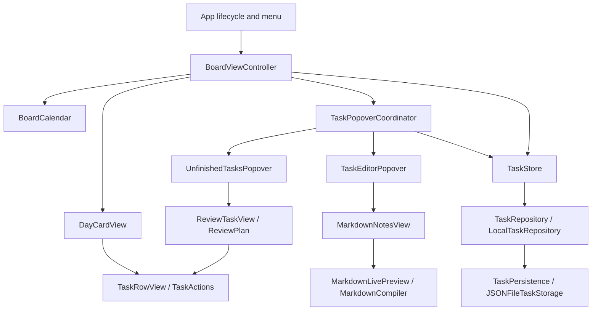

# Seven Day Todo

A local-first macOS task app with a four-day board, a calendar month overview,
Markdown notes, and a review of unfinished tasks from earlier days.

## Features

- Default board: yesterday, today, tomorrow, and the following day
- Month grid with local first-weekday settings, month navigation, and Today reset
- One shared task row for opening, completing, deleting, and dragging tasks
- Compact autosaving task editor with title, date, completion, and one Markdown Notes field that grows with its content
- Markdown rendered by default; the line containing the insertion cursor reveals its source
- Unfinished-task review with rescheduling, completion, batch updates, and Undo
- Nested editing from the review; returning to the list saves and closes its editor, Cancel discards edits, and clicking outside saves and closes the group
- Atomic local JSON persistence, stable task identities, and soft deletion
- Native light and dark appearances

## Requirements and build

macOS 14 or later, plus Apple Command Line Tools with a matching Swift 6 toolchain
and macOS SDK. Full Xcode and third-party packages are not required.

```sh
./scripts/build-app.sh
```

The signed personal-use app is written to `dist/Seven Day Todo.app`.
The build script uses the standard Swift compiler directly for this dependency-free
app. It keeps compiler caches and optimized binaries in `.build/app-release`,
retains debug symbols, and signs/verifies the bundle with Hardened Runtime enabled.
It needs no elevated execution and does not disable sandbox protections.

## Checks

Run persistence, calendar, planning, validation, failure-recovery, and Markdown checks:

```sh
./scripts/test-app.sh
```

Include isolated AppKit window/popover checks:

```sh
./scripts/test-app.sh --ui
```

Run a single group or check by a substring of its name:

```sh
./scripts/test-app.sh --filter RepositoryTests
./scripts/test-app.sh --ui --filter Popover
```

The suite includes named checks for failed-write rollback, draft retry and cancellation,
duplicate-save prevention, deletion, reordering, migration, corrupt storage, Unicode notes,
sync metadata, review Undo recovery, and date boundaries. UI checks include real mouse
switching between unfinished tasks, blank-task dismissal, and independent trash/checkbox actions.
An unmatched filter exits with an error rather than silently running no checks.

The checks use temporary or in-memory task storage, never your saved tasks.
They compile the production sources into a separate runner in `.build/checks`,
excluding only the application's entry point/delegate. Command Line Tools do not
provide a usable XCTest/Swift Testing installation on every supported setup, so
this runner has no dependency on those frameworks. Test code is not shipped in the app.
The former app flags `--self-test` and `--ui-self-test` have been replaced by these scripts.

For optional light/dark layout captures during UI checks:

```sh
SEVEN_DAY_TODO_SNAPSHOTS=/tmp/seven-day-todo-previews ./scripts/test-app.sh --ui
```

## Architecture



- `UI/AppUI` supplies stack layouts, labels, separators, date pickers, spacers, and edge constraints.
  `StackScrollView` gives task lists consistent width tracking and top alignment.
- `TaskRowView` and `TaskActions` provide the same task controls and behavior in day cards and review rows.
- `AppPopover` owns shared close-lifecycle rules. `TaskPopoverCoordinator` owns nested editors,
  outside-click monitoring, save-before-switch validation, and drag-source retention.
- `BoardCalendar` contains calendar navigation, including preserving the preferred day across short months.
- `ReviewPlan` converts choices into task updates without depending on AppKit.
- `TaskStore` coordinates drafts, visible data, errors, and review Undo. It groups visible tasks by day
  and accepts an injected calendar and clock for deterministic checks.
- `LocalTaskRepository` validates mutations, normalizes task order, and commits a candidate snapshot
  only after persistence succeeds. Unchanged edits do not write or update sync timestamps.
- `JSONFileTaskStorage` handles ISO-8601 compatibility, legacy-format migration, and atomic writes.
  Invalid dates, duplicate task IDs, and invalid sort orders are reported without silently repairing data.

## Stored data

The app writes `~/Library/Application Support/SevenDayTodo/tasks.json` as a task-only
JSON array. The first version's arrays without notes and the intermediate version-1
object envelope remain readable. Existing task IDs, notes, dates, completion state,
soft-deletion markers, and sync metadata are preserved.

Notes remain raw Markdown in storage. The renderer changes presentation attributes
only. It supports headings, emphasis, blockquotes, lists, inline code, links,
strikethrough, horizontal rules, and fenced code. It is a lightweight inline editor,
not a complete CommonMark implementation or an HTML/image renderer.

The native bundle uses `Resources/AppIcon.icns`, referenced by `Resources/Info.plist`.
`favicon.svg` is a separate web asset. The build copies the native icon and updates
the bundle modification date for Finder/Dock discovery.

See [CODEBASE_REVIEW.md](CODEBASE_REVIEW.md) for the review findings and refactor details.
